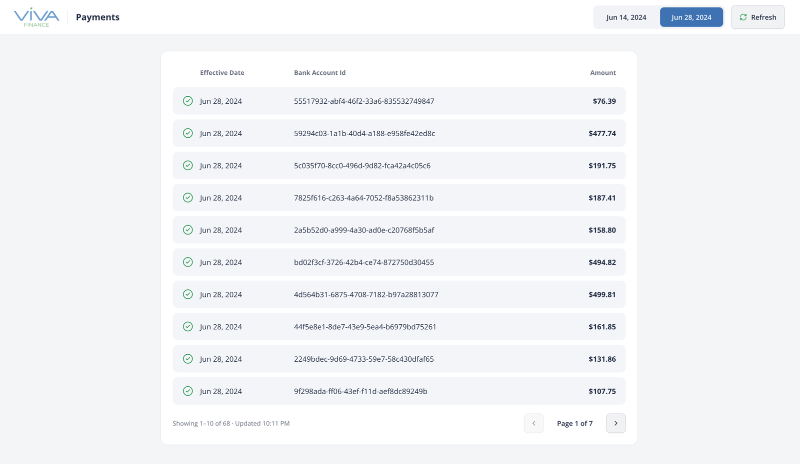

# VIVA Payments

A single-page React app that loads every payment for one of two dates from VIVA's
cursor-paginated payments API and shows them in a paginated table.



## Quick start

Requires **Node 24 LTS or newer** (`.nvmrc` pins 26).

```bash
nvm use                 # optional: switch to the pinned Node version
npm install
cp .env.example .env    # then paste the API token after VITE_API_TOKEN=
npm run dev             # http://localhost:5173
```

> **On a VPN?** The payments API rejected requests over a VPN with
> `403 Forbidden` during development. Turn the VPN off, or use the mock (below).

### Scripts

| Command | What it does |
|---|---|
| `npm run dev` | Dev server with hot reload |
| `npm run build` | Type-check and build to `dist/` |
| `npm run preview` | Serve the production build locally |
| `npm test` | Run the unit tests (Vitest, watch mode) |
| `npm run lint` | ESLint |

### Environment variables

| Variable | Purpose |
|---|---|
| `VITE_API_BASE` | `/api`, proxied to the payments API by Vite (see below) |
| `VITE_API_TOKEN` | Bearer token from the challenge brief |
| `VITE_USE_MOCK` | `true` = local mock data, no network. `false` = real API |
| `VITE_MOCK_FAIL_RATE` | Mock only. Fraction of calls that fail (e.g. `0.2`) to exercise the error state |

Vite reads `.env` at startup, so restart `npm run dev` after changing it.

## How the API behaves

Confirmed by calling it directly before building:

- **One payment per request.** Start with `continuationToken=START` and follow the
  token until it equals `END`.
- **Naming quirk:** the request parameter is `continuationToken`, but the response
  field is `paginationToken`.
- **The token is the next payment's `paymentId`**, so the chain is a linked list.
- **The response carrying `END` is still a real payment**, so it's kept.
- **Counts:** Jun 14 has 13 payments; Jun 28 has 68. The brief says production
  volume is unknown, so nothing assumes small counts.
- **No CORS headers for localhost**, so the browser blocks direct calls. Requests go
  to `/api`, and Vite's dev/preview server forwards them to the API (see
  `vite.config.ts`). A production deployment would need its own proxy or backend,
  which would also keep the token out of the browser.

## Architecture

```
src/
  api/
    payments.ts         fetchPayment(): one request; picks live API or mock
    mockPayments.ts     mock with the same behavior (seeded data, abortable delay)
    errors.ts           ApiError (carries HTTP status), isAbortError
  state/
    paymentsReducer.ts  pure reducer, state kept separately per date
  hooks/
    paymentsChain.ts    runChain(): follows the token chain, dispatches each payment
    usePayments.ts      React wiring: when to start, abort, resume, refresh, retry
  lib/
    pagination.ts       getPageView(): which rows to show, whether the page is ready
    format.ts           date / currency / time formatting
    constants.ts        dates, page size, env flags
  components/           Header, DateToggle, RefreshButton, PaymentsTable,
                        PaymentRow, SkeletonRows, Pagination, ErrorBanner
  App.tsx               selected date + page; wires the hook to the components
```

**Data flow:** `App` calls `usePayments(date)` → the hook runs `runChain()` →
each response is dispatched to the reducer → `App` slices the current page with
`getPageView()` and renders it.

## Decisions and trade-offs

**Loading: show the first page once it's full.** Every payment is a separate,
sequential request, and the total is unknown, so waiting for `END` could mean a long
skeleton (Jun 28 is 68 requests). Instead, a page appears once it's full, so rows
never trickle in one at a time; the page still filling shows skeleton rows; and the
page count reads "N+" until loading finishes.

**Cancel, cache and resume per date.** Switching dates aborts the running chain
(`AbortController`), so a late response can never land in the other date's table.
Each date keeps its own rows and `nextToken`: a finished date is instant when you
return to it, and an unfinished one resumes instead of restarting. **Refresh** aborts
and starts over from `START`; **Retry** (after an error) resumes from the last good
token. The reducer also ignores results for a date that isn't loading, as a second
safeguard.

**`useReducer` in a custom hook, not Redux or TanStack Query.** It's one page with one
data source. The goal was to keep the pagination, cancellation and caching logic
visible and testable. In production I'd move this to RTK Query or TanStack Query
(`useInfiniteQuery`) for cache invalidation, background refetching and retry with
backoff.

**`useEffectEvent`** (React 19.2+) lets the effect read the latest state without
listing it as a dependency, which would restart the chain after every payment. The
one ref holds the active `AbortController` so Refresh can cancel it.

**Prev/next pagination, not numbered pages.** Numbered buttons don't scale to an
unknown count (500 payments = 50 buttons).

**Dates are formatted in UTC.** `new Date("2024-06-14")` is midnight UTC, which shows
as Jun 13 in US timezones. `effectiveDate` is a calendar date, so the viewer's
timezone shouldn't change it. A test runs under `TZ=America/Los_Angeles` to prove it.

**Small departures from the Figma:**
- **Row background** is slightly darker (`#F3F5F8` vs `#F8F9FB`). The original is
  about 1.05:1 against white and disappears on bright displays.
- **Amounts** use one rule: a minus sign for negatives, nothing for positives. The
  Figma mixed `-$`, `$` and `+` with no `$`.
- **The check icon is decorative** (`aria-hidden`), because the API has no status
  field.

**The refresh icon spins only after Refresh is clicked**, not on every load. Skeleton
rows and the footer already show progress for date switches.

## Error and empty states

- **Error banner** (`role="alert"`) above the table, with rows already loaded kept
  visible and a **Retry** button that resumes from the last token. A 403 suggests
  turning off a VPN.
- **Empty state** ("No payments for …") when a date returns nothing. The current API
  always returns at least one payment, but production data is unknown.

## Accessibility

- Real `<table>` with a caption that includes the date ("Payments for Jun 28, 2024")
- `aria-pressed` on the date toggle; `aria-busy` on the table while loading
- A screen-reader status message that changes only when loading starts and finishes,
  not on every payment
- Visible focus rings; every control works with the keyboard
- Skeleton animation stops when the OS "Reduce motion" setting is on

## Tests

`npm test`: 26 unit tests with Vitest.

| File | Covers |
|---|---|
| `format.test.ts` | UTC date formatting, currency |
| `payments.test.ts` | Mock follows the real API's chain; abort; live client sends the right URL and header and throws `ApiError` |
| `paymentsReducer.test.ts` | Append, dedupe by `paymentId`, refresh vs resume, error keeps rows, abort keeps progress, stray results ignored |
| `paymentsChain.test.ts` | Dispatch order, `END` payment kept, **no dispatches after abort (the date-switch race)**, error messages |
| `pagination.test.ts` | Reveal rule, page clamping, empty result |

To try the error state by hand: set `VITE_MOCK_FAIL_RATE=0.2`, restart, pick Jun 28,
and use Retry.

## Known limitations

- **The API token is in the browser bundle.** Fine for a challenge; a real app would
  proxy requests through a backend.
- **No automatic retry.** A failed request stops the chain until the user clicks
  Retry.
- **Narrow screens:** the table scrolls sideways rather than switching to a card
  layout.
- **The logo** is an SVG traced from the marketing site, not the official asset.

## TODO

- [ ] Retry 429/5xx automatically with exponential backoff before showing the banner
- [ ] Stacked card layout for rows on small screens
- [ ] Virtualize rows or offer a larger page size for very long days
- [ ] Drive the status icon from a real status field once the API has one
- [ ] Persist the cache in `sessionStorage` with a staleness window
- [ ] Integration test for the hook with React Testing Library
- [ ] Move to RTK Query / TanStack Query if more screens use payment data
